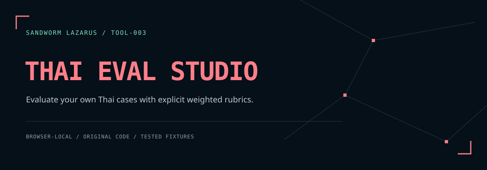

# Sandworm Thai Eval Studio



**Compare saved Thai-language answers against explicit, reproducible rules.** A browser-local evaluation workspace with a reusable JavaScript engine. It imports JSON datasets and model outputs, applies weighted pass/fail assertions, and exports a report tied to both exact input files by SHA-256.

[ภาษาไทย](README.th.md) · [Fixture format](docs/FIXTURE_FORMAT.md) · [Threat model](docs/THREAT_MODEL.md) · [Development](docs/DEVELOPMENT.md)

The bundled **synthetic-A** and **synthetic-B** answers are invented examples, not results from real AI models. The browser does not call a model or execute candidate code. The optional Promptfoo worker can call your selected API after explicit opt-in. Neither component verifies cited source content or provides a general model leaderboard.

## Run locally

No dependency installation or build step is required.

```sh
python3 -m http.server 8080 --bind 127.0.0.1 --directory dist
```

Open `http://127.0.0.1:8080`, choose **ลองข้อมูลสมมติ**, then **ประเมินคำตอบ**. The example scores are **100%** and **10%**, with one missing answer in synthetic-B.

Node.js users can run `npm run serve` when Python 3 is available. Serve over localhost or HTTPS so browser WebCrypto can calculate SHA-256. The app's assets, fonts, and processing are local; the hosted page itself still requires an initial download. No direct-file browser compatibility claim is made.

## What it checks

| Assertion | Behavior |
| --- | --- |
| `exact` | Entire text equality after the selected normalization |
| `contains` / `notContains` | All required phrases present / all forbidden phrases absent |
| `json.requiredKeys` | Valid JSON object containing the specified own top-level keys |
| `citations` | Exact set equality of citation IDs supplied in output metadata |
| `abstain` | Explicit output `abstained` boolean matches the expected value |

Each case must pass **all** its assertions. Its weight counts once. The score is `passed case weight / total dataset weight × 100`. Missing answers fail and remain in the denominator. Unknown and duplicate IDs, duplicate JSON object members, unsupported properties, and invalid weights are rejected.

NFC and whitespace normalization can be toggled independently. Neither option translates text, folds case, removes punctuation, or segments Thai words. NFC does not merge every visually similar Thai spelling. JSON structure and citation IDs are evaluated without text normalization.

## Workflow

1. Edit or import the dataset and candidates as UTF-8 `.json` files.
2. Choose normalization and evaluate. All models use the same complete dataset.
3. Compare the summary and choose a model to inspect case-level reasons.
4. Download the report. Any input or normalization change invalidates the old report immediately.

Reports omit raw answers and expected phrases, but retain dataset/model/case IDs, rule results, weights, settings, and input hashes. Review identifiers before sharing. The separate **ดาวน์โหลดเกณฑ์** action exports the dataset itself and therefore includes its expected text.

## Files and limits

- 1 MiB UTF-8 per input, 200 cases, 10 model output sets, 32 JSON nesting levels.
- At most 32,768 UTF-16 code units per answer or exact-match expectation.
- IDs: 1–64 ASCII letters/digits/dot/underscore/hyphen, starting with a letter or digit.
- Weights: finite numbers greater than 0 and at most 1,000.
- Phrase/key/citation lists: at most 50 unique entries; strings at most 512 code units, nonblank.

[examples/dataset.json](examples/dataset.json) and [examples/candidates.json](examples/candidates.json) show the complete format. [examples/expected-report.json](examples/expected-report.json) is generated by the actual engine, with hashes of those files including their trailing newlines.

## Reproduce and integrate

Requires Node.js 20+; locally verified with Node.js 24.22.1.

```sh
npm test
npm run check
node examples/run.cjs
```

`npm run check` runs the repository checks and writes `reports/validation.json`, including SHA-256 source and fixture provenance. It is a local verification record, not a claim that hosted CI passed.

```js
const { evaluate } = require('./dist/engine.js');
const report = await evaluate(datasetJsonText, candidatesJsonText, {
  nfc: true,
  whitespace: true
});
```

The public string API validates bounded JSON and adds SHA-256 provenance. `evaluateObjects()` accepts trusted already-parsed objects and performs schema validation and scoring without file hashes. Scores use JavaScript floating-point arithmetic; display rounding does not alter the exported raw score.

## Original work and theme

This project implements its own evaluator, input schemas, browser controller, and synthetic fixtures. The dark navy/coral design follows the owner's [Sandworm Lazarus site](https://sandworm-lazarus.pages.dev/), with original local network artwork and embedded Chakra Petch, Anuphan, and JetBrains Mono fonts. No external font service is used.

Application code: [MIT](LICENSE). Fonts: SIL OFL 1.1, with [third-party notices](THIRD_PARTY_NOTICES.md).

## Sandworm tools

[Skill Doctor](https://github.com/Sandworm-Lazarus/sandworm-skill-doctor) · [GameGuard Lab](https://github.com/Sandworm-Lazarus/sandworm-gameguard-lab) · [AI Run Ledger](https://github.com/Sandworm-Lazarus/sandworm-ai-run-ledger) · [Agent Gate](https://github.com/Sandworm-Lazarus/sandworm-agent-gate) · [Privacy Workbench](https://github.com/Sandworm-Lazarus/sandworm-privacy-workbench)

## Optional cloud worker integration

[Promptfoo saved-output and API bridge](integrations/promptfoo/README.md) adds a separately run integration with pinned upstream dependencies, synthetic fixtures, regression tests and SHA-256 validation records. See its guide for installation, privacy boundaries and verified integration scope. The browser application remains independently usable.

### Promptfoo API comparison

The [Promptfoo worker](integrations/promptfoo/) now runs a bounded prompt-version matrix against an explicitly selected Chat Completions endpoint, including self-hosted endpoints. Import its JSON bundle into **Thai Eval Studio → Promptfoo / API runs** to recompute weighted scores and compare API calls, errors, tokens and time. Credentials remain in the worker environment; the browser remains offline. Real Promptfoo + loopback HTTP is tested; paid/authenticated model calls and visual QA for this new panel are not claimed.
