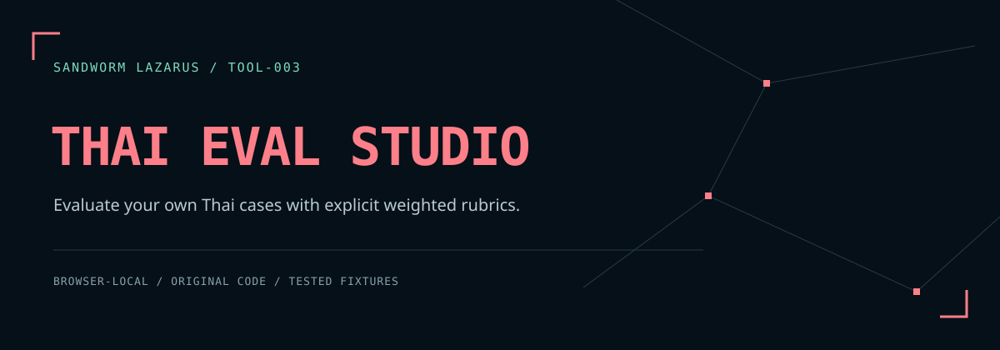

# Sandworm Thai Eval Studio



เครื่องมือเทียบคำตอบภาษาไทยจากไฟล์ JSON ด้วยเกณฑ์ที่กำหนดเอง ประมวลผลในเบราว์เซอร์ คิดคะแนนถ่วงน้ำหนัก และส่งออกรายงานพร้อม SHA-256 ของข้อมูลต้นฉบับทั้งสองไฟล์

[English](README.md) · [รูปแบบไฟล์](docs/FIXTURE_FORMAT.md) · [ขอบเขตความปลอดภัย](docs/THREAT_MODEL.md)

**synthetic-A / synthetic-B เป็นข้อมูลสมมติ** ไม่ใช่ผลทดสอบโมเดลจริง เครื่องมือนี้ไม่เรียก API โมเดล ไม่รันโค้ดในคำตอบ และไม่ตรวจว่าเนื้อหาในแหล่งอ้างอิงถูกต้องหรือไม่

## เปิดใช้งาน

ไม่ต้องติดตั้งแพ็กเกจหรือ build

```sh
python3 -m http.server 8080 --bind 127.0.0.1 --directory dist
```

เปิด `http://127.0.0.1:8080` กด **ลองข้อมูลสมมติ → ประเมินคำตอบ** จะได้คะแนน 100% และ 10% โดย synthetic-B ขาดคำตอบ 1 เคส ใช้ localhost หรือ HTTPS เพื่อให้ WebCrypto คำนวณ SHA-256 ได้

## วิธีคิดคะแนน

ทุก assertion ในเคสต้องผ่าน จึงได้น้ำหนักของเคสนั้น คะแนน = น้ำหนักที่ผ่าน ÷ น้ำหนักทั้งหมด × 100 คำตอบที่ขาดนับว่าไม่ผ่านและไม่ถูกตัดออกจากตัวหาร ID ที่ซ้ำหรือไม่อยู่ในชุดเกณฑ์จะถูกปฏิเสธ

| กฎ | ตรวจอะไร |
| --- | --- |
| `exact` | ข้อความทั้งประโยคตรงกัน |
| `contains` / `notContains` | มีทุกวลีที่กำหนด / ไม่มีทุกวลีต้องห้าม |
| `json.requiredKeys` | เป็น JSON object และมีคีย์ระดับบนตามที่ระบุ |
| `citations` | ชุด ID แหล่งอ้างอิงตรงกัน รวมทั้งจำนวน |
| `abstain` | ค่า `abstained` ที่ใส่มาชัดเจนตรงกับผลที่คาด |

เลือก NFC และการรวมช่องว่างได้ ไม่แปลงตัวพิมพ์ ไม่ตัดคำไทย ไม่ลบเครื่องหมายวรรคตอน และไม่ใช้ AI ตัดสินความหมาย JSON และ citation ID เทียบตามโครงสร้าง/ข้อความเดิม

## นำข้อมูลของคุณมาใช้

1. ใช้ [dataset.json](examples/dataset.json) เป็นแบบสำหรับเกณฑ์ และ [candidates.json](examples/candidates.json) สำหรับคำตอบ
2. วางหรือเลือกไฟล์ UTF-8 `.json` แต่ละช่องไม่เกิน 1 MiB
3. ประเมิน ดูตารางเปรียบเทียบ และเลือกรายการเพื่อดูเหตุผลรายเคส
4. ดาวน์โหลดรายงาน JSON ก่อนแชร์ตรวจ ID ของโมเดล เคส และชุดข้อมูลด้วย

รายงานไม่ใส่คำตอบหรือข้อความที่คาดหวัง แต่ยังมี ID น้ำหนัก กฎ และ hash การแก้ข้อมูลหรือ normalization จะล้างผลเดิมและปิดปุ่มส่งออกทันที ส่วนปุ่ม **ดาวน์โหลดเกณฑ์** ส่งออกชุดข้อมูลต้นฉบับซึ่งยังมีข้อความคาดหวัง

จำกัด 200 เคส / 10 ชุดคำตอบ / JSON ลึกไม่เกิน 32 ชั้น / คำตอบไม่เกิน 32,768 code units ต่อเคส รายละเอียดทั้งหมดอยู่ใน [รูปแบบไฟล์](docs/FIXTURE_FORMAT.md)

## ตรวจซ้ำ

```sh
npm test
npm run check
node examples/run.cjs
```

ทดสอบใน Node.js 24.22.1; `npm run check` สร้าง `reports/validation.json` พร้อม SHA-256 ของไฟล์และ fixture ไม่ได้หมายความว่า GitHub Actions ผ่านแล้ว ดูขอบเขตการทดสอบใน [DEVELOPMENT.md](docs/DEVELOPMENT.md)

โค้ด evaluator, UI และ fixture เขียนสำหรับโปรเจกต์นี้ ธีมอิง [เว็บ Sandworm Lazarus](https://sandworm-lazarus.pages.dev/) ฟอนต์เก็บในไฟล์ CSS ของโปรเจกต์และมีใบอนุญาตครบ

โค้ด [MIT](LICENSE) · ฟอนต์ SIL OFL 1.1 ตาม [THIRD_PARTY_NOTICES.md](THIRD_PARTY_NOTICES.md)

## Sandworm tools

[Skill Doctor](https://github.com/Sandworm-Lazarus/sandworm-skill-doctor) · [GameGuard Lab](https://github.com/Sandworm-Lazarus/sandworm-gameguard-lab) · [AI Run Ledger](https://github.com/Sandworm-Lazarus/sandworm-ai-run-ledger) · [Agent Gate](https://github.com/Sandworm-Lazarus/sandworm-agent-gate) · [Privacy Workbench](https://github.com/Sandworm-Lazarus/sandworm-privacy-workbench)
